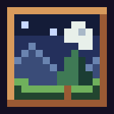
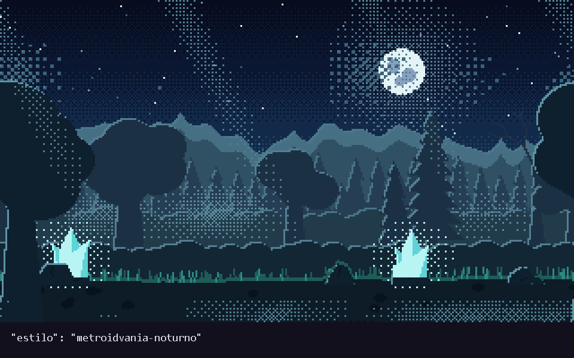
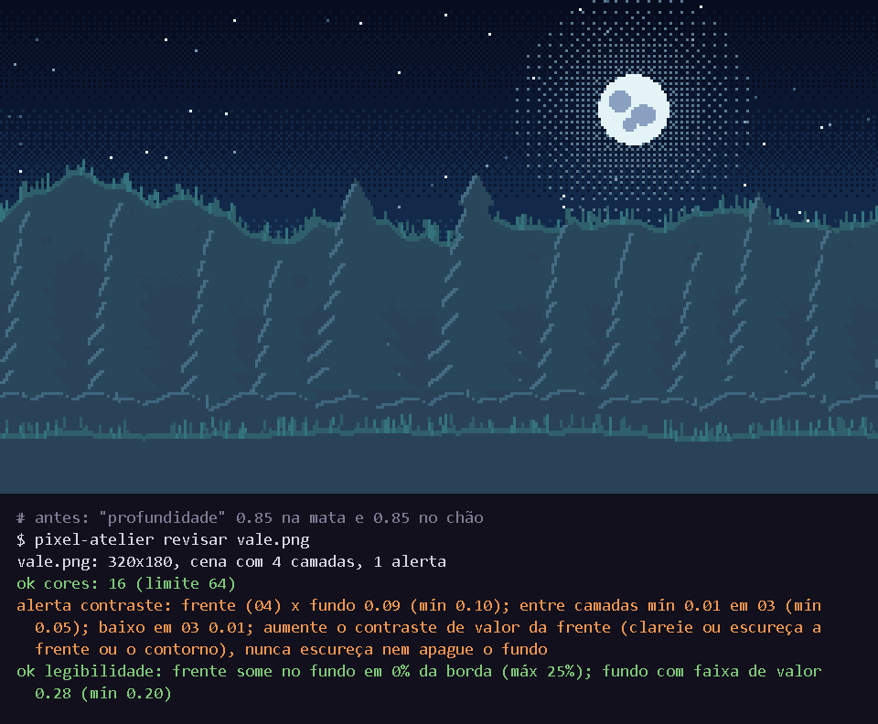
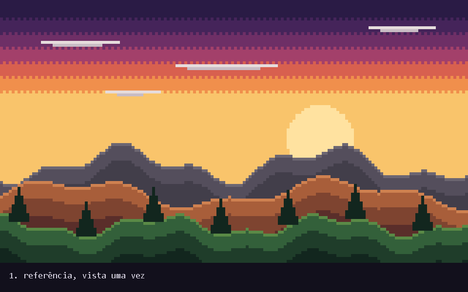

<p align="center">
  
</p>

<h1 align="center">pixel-atelier</h1>

<p align="center">
  
  
</p>

<p align="center">
  <a href="docs/referencia.md">Referência</a>
  &nbsp;•&nbsp;
  <a href="pixel_atelier/guia/indice.md">Guia de pixel art</a>
  &nbsp;•&nbsp;
  <a href="embalagens/README.md">Embalagens</a>
  &nbsp;•&nbsp;
  <a href="AGENTS.md">Para agentes</a>
</p>

Ateliê de pixel art para agentes de IA. O agente escreve uma receita JSON curta e lê as respostas em texto; a técnica (paleta, rampas, luz, pontilhado, laço sem emenda) fica guardada no motor, e a mesma receita com a mesma seed dá sempre os mesmos pixels.








## Destaques

- **Cena inteira numa receita:** céu, nuvens, montanhas, árvores, rochas, cristais, névoa e raios em camadas, do fundo para a frente. Toda camada dá a volta na horizontal sem emenda, pronta para parallax.
- **Revisão em texto:** o `revisar` confere cores, contraste, legibilidade, pixel solto, pillow shading, serrilhado, escala, repetição e a emenda do laço, com o número e o lugar de cada problema. O agente só abre a imagem na aprovação final.
- **Estilo a partir de uma referência:** o `ref` lê a imagem uma vez e grava paleta e rampas como preset com nome; depois a receita usa só o nome.
- **Guia de pixel art por capítulo:** o agente lê só o assunto da vez, e cada regra do `revisar` aponta para o capítulo que a explica.
- **Qualquer agente:** servidor MCP local e embalagens prontas para Claude Code, Codex, Gemini CLI, Cursor e GitHub Copilot.

## Instalação

O servidor vem do pacote Python:

```
pip install "pixel-atelier[mcp] @ git+https://github.com/guavovic/pixel-atelier"
```

No Claude Code, o plugin entra por dentro de uma sessão:

```
/plugin marketplace add guavovic/pixel-atelier
/plugin install pixel-atelier@pixel-atelier
```

| Ferramenta | Embalagem | Situação |
| --- | --- | --- |
| Claude Code | plugin com o servidor MCP e uma skill | testado de ponta a ponta (#8) |
| OpenAI Codex | skill e servidor em `.codex/config.toml` | formato validado pela documentação e servidor testado com cliente MCP; teste de ponta a ponta pendente |
| Gemini CLI | extensão com `gemini-extension.json` e `GEMINI.md` | formato validado pela documentação e servidor testado com cliente MCP; teste de ponta a ponta pendente |
| Cursor | regra em `.cursor/rules/` e servidor em `.cursor/mcp.json` | formato validado pela documentação e servidor testado com cliente MCP; teste de ponta a ponta pendente |
| GitHub Copilot | `copilot-instructions.md` e servidor em `mcp.json` (VS Code e Copilot CLI) | formato validado pela documentação e servidor testado com cliente MCP; teste de ponta a ponta pendente |

Onde colocar cada embalagem está em [`embalagens/README.md`](embalagens/README.md). Outro cliente MCP usa a configuração `mcpServers` da [referência](docs/referencia.md#servidor-mcp).

## Como foi feito

O motor é Python com Pillow e mais nada. Cada forma devolve uma camada no tamanho real de pixel, só com cores da paleta e alfa 0 ou 255. Posições e tamanhos são frações da altura, então a mesma receita serve em qualquer resolução, e a `profundidade` puxa as cores para a atmosfera do estilo, que é o que separa uma camada da outra. Desenho e máscaras dão a volta na borda, por isso o laço fecha sem emenda.

As embalagens saem de um script só, a partir do `AGENTS.md`, do guia e das ferramentas do servidor, e os GIFs desta página foram gerados pelo próprio pacote.

## Tecnologias

- **Linguagem:** Python 3.11+.
- **Imagem:** Pillow.
- **Integração com agentes:** MCP (SDK oficial em Python).

---

<sub>Licença MIT · Feito por [guavovic](https://github.com/guavovic)</sub>
