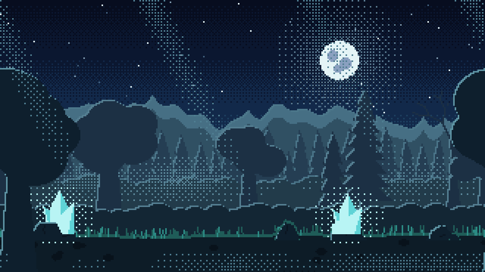
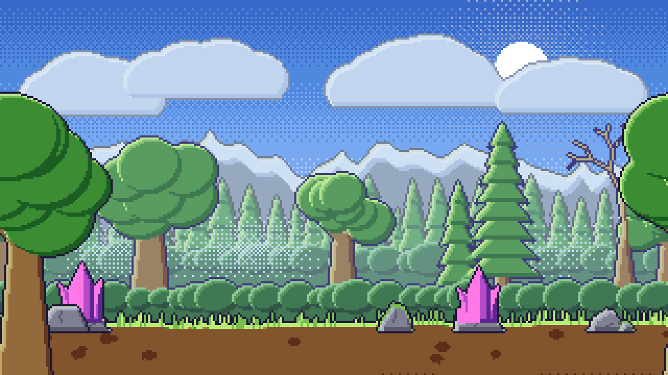
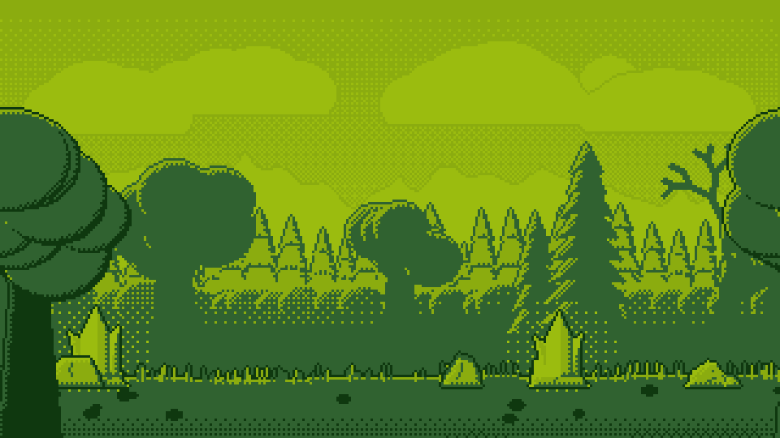

# pixel-atelier

Ateliê de pixel art para agentes de IA. O motor guarda a técnica (paleta, rampas, luz, pontilhado, laço sem emenda) e as formas; o agente só escolhe o que vai na cena. Tudo é determinístico por seed.

> README de trabalho. A vitrine do projeto vem na #9.

## O que já existe (v0.1, issue #1)

- **Técnicas** (`pixel_atelier/`)
  - `cor.py`: rampas com mudança de matiz (`gerar_rampa`), mistura, quantização para a paleta (`quantizar`).
  - `estilo.py`: o `Estilo` (paleta, rampas por papel, atmosfera, luz, jeito de sombrear), lido de dicionário ou JSON.
  - `pontilhado.py`: dithering ordenado de Bayer 4x4 (`mascara_pontilhada`, `degrade`).
  - `tela.py`: tela com laço horizontal; desenho e operações de máscara dão a volta na borda.
  - `pintura.py`: volume por faixas de luz e sombra, luz de contorno, contorno, limpeza de pixel solto.
  - `imagem.py`: `compor`, `ampliar` (vizinho mais próximo) e `ladrilhar`.
- **Formas** (`pixel_atelier/formas/`): `ceu`, `nuvem`, `terreno`, `arvore`, `rocha`, `cristal`, `nevoa`, `raios`. Cada uma devolve uma camada RGBA no tamanho real de pixel, só com cores da paleta e alfa 0 ou 255.
- **Estilos** (`pixel_atelier/estilos/*.json`): `metroidvania-noturno`, `snes-diurno`, `game-boy`.
- **Exemplo**: `exemplos/montar_cena.py` monta a mesma receita nos três estilos.

## Receitas (issue #2)

- `receita.py`: formato da receita em JSON, validado antes de desenhar (`validar_receita`), com todos os erros de uma vez e sugestão de nome parecido.
- `gerador.py`: `gerar(receita, pasta)` desenha tudo e devolve um `Resultado` com `resumo()` em texto e `para_dicionario()`.
- `__main__.py`: linha de comando `gerar`, `formas`, `estilos` e `registrar-estilo`.
- **Presets**: estilo por nome, `{"base": "preset", ...}` para mudar só alguns campos, `registrar_estilo` para guardar um estilo novo com nome.
- **Exemplos**: `exemplos/metroidvania-noturno.json` e `exemplos/snes-diurno.json` dão os mesmos pixels que `montar_cena.py`.

| metroidvania-noturno | snes-diurno | game-boy |
| --- | --- | --- |
|  |  |  |

## Servidor MCP (issue #3)

`servidor.py` expõe o ateliê por MCP (stdio), para qualquer cliente que fale o protocolo. O núcleo continua só com Pillow; o servidor vem no extra `mcp`.

```
pip install pixel-atelier[mcp]
pixel-atelier mcp --raiz caminho/do/projeto   # ou python -m pixel_atelier mcp
```

| Ferramenta | O que faz |
| --- | --- |
| `gerar` | desenha uma receita (objeto, texto JSON ou caminho) e grava os PNGs; responde com o resumo |
| `descrever_formas` | formas e parâmetros, com o padrão |
| `listar_estilos` | presets do pacote e do usuário |
| `registrar_estilo` | guarda um estilo (objeto ou caminho `.json`) como preset com nome |

Toda resposta é texto curto, nunca a imagem. Receita inválida volta como erro com a lista de problemas.

**Caminhos**: o servidor só lê e grava dentro da raiz (`--raiz`, ou a pasta onde ele subiu). Caminho relativo parte da raiz; caminho absoluto ou com `..` que saia dela é recusado. Sem `pasta`, `gerar` grava ao lado do arquivo da receita, ou na raiz quando a receita vem como objeto. `registrar_estilo` grava na pasta de presets do usuário, como na linha de comando.

Configuração num cliente MCP genérico (o formato `mcpServers` que a maioria aceita):

```json
{
  "mcpServers": {
    "pixel-atelier": {
      "command": "pixel-atelier",
      "args": ["mcp", "--raiz", "/caminho/do/projeto"]
    }
  }
}
```

Se o comando `pixel-atelier` não estiver no PATH do cliente, use `"command": "python"` com `"args": ["-m", "pixel_atelier", "mcp", "--raiz", "..."]`.

## Uso

```python
from pixel_atelier import ampliar, carregar_estilo, compor, desenhar

estilo = carregar_estilo("snes-diurno")
cena = compor([
    desenhar("ceu", estilo, 320, 180, astro="sol"),
    desenhar("terreno", estilo, 320, 180, seed=3, profundidade=0.85, base=0.62, amplitude=0.3, papel="pedra"),
    desenhar("arvore", estilo, 320, 180, seed=4, profundidade=0.4, tipo="mista", base=0.85),
    desenhar("terreno", estilo, 320, 180, seed=5, base=0.88),
])
ampliar(cena, 3).save("cena.png")
```

Toda forma tem a mesma assinatura: `forma(estilo, largura, altura, *, seed=0, profundidade=0.0, laco=True, deslocamento=0, **parametros)`. Posições e tamanhos são frações da altura, então a mesma receita serve em qualquer resolução. Com laço, a largura precisa ser múltipla de 8.

`profundidade` vai de 0 (perto) a 1 (fundo) e puxa as cores para a atmosfera do estilo: é o que separa as camadas.

### Receita

A cena inteira cabe num JSON curto. Só `camadas` é obrigatório; as camadas vão do fundo para a frente.

```json
{
  "cena": "vale",
  "tamanho": [320, 180],
  "estilo": {"base": "snes-diurno", "contorno": false},
  "seed": 7,
  "ampliar": 3,
  "camadas": [
    {"forma": "ceu", "astro": "sol", "posicao": [0.78, 0.18]},
    {"forma": "terreno", "nome": "montanhas", "profundidade": 0.85, "base": 0.62, "amplitude": 0.3, "papel": "pedra"},
    {"forma": "arvore", "profundidade": 0.4, "tipo": "mista", "base": 0.85},
    {"forma": "terreno", "nome": "chao", "seed": 5, "base": 0.88}
  ]
}
```

| Campo | Padrão | O que é |
| --- | --- | --- |
| `cena` | `"cena"` | nome dos arquivos de saída |
| `descricao` | `""` | texto livre |
| `tamanho` | `[320, 180]` | largura e altura reais |
| `estilo` | `"snes-diurno"` | preset, caminho de JSON ou dicionário de estilo (aceita `base`) |
| `laco` | `true` | laço horizontal; com ele a largura precisa ser múltipla de 8 |
| `seed` | `0` | sorteia as camadas sem `seed` própria; camada com `seed` fica fixa |
| `ampliar` | `1` | grava também o composto ampliado N vezes (de 1 a 16; o ampliado fica com no máximo 4096 por lado) |
| `saida` | `"tudo"` | `"tudo"`, `"composto"` ou `"camadas"` |
| `camadas` | obrigatório | `forma`, `nome` opcional e os parâmetros da forma |

```
python -m pixel_atelier gerar receita.json [--pasta saida]   # ou "-" para ler da entrada padrão
python -m pixel_atelier formas                               # parâmetros de cada forma, com o padrão
python -m pixel_atelier estilos
python -m pixel_atelier registrar-estilo meu-estilo.json [--nome nome] [--sobrescrever]
```

Grava `<cena>.png`, `<cena>-3x.png` e `<cena>/01-ceu.png`... e responde em texto, sem precisar abrir a imagem:

```
vale: 320x180, estilo snes-diurno, com laço, seed 7, 4 camadas
composto: saida/vale.png, saida/vale-3x.png
cores: 28 de 146 da paleta
camadas em saida/vale (seed, área coberta, cores):
  01 ceu: seed 10909, 100%, 7 cores 01-ceu.png
  02 montanhas: seed 33290, 57%, 6 cores 02-montanhas.png
  03 arvore: seed 45195, 33%, 10 cores 03-arvore.png
  04 chao: seed 5, 15%, 6 cores 04-chao.png
```

Camada vazia ou que tapa a tela inteira sai como `aviso:` no fim.

Os presets do usuário ficam em `~/.pixel-atelier/estilos` (ou na pasta da variável `PIXEL_ATELIER_ESTILOS`). Os nomes do pacote são reservados.

## Desenvolvimento

```
pip install -e .[dev]
pytest
python exemplos/montar_cena.py
python -m pixel_atelier gerar exemplos/snes-diurno.json
```

Requer Python 3.11+ e Pillow. Sem numpy. O servidor MCP pede o pacote `mcp` (extra `[mcp]`, já incluso no `[dev]`). O servidor MCP pede o pacote `mcp` (extra `[mcp]`, já incluso no `[dev]`).

## Licença

MIT.
